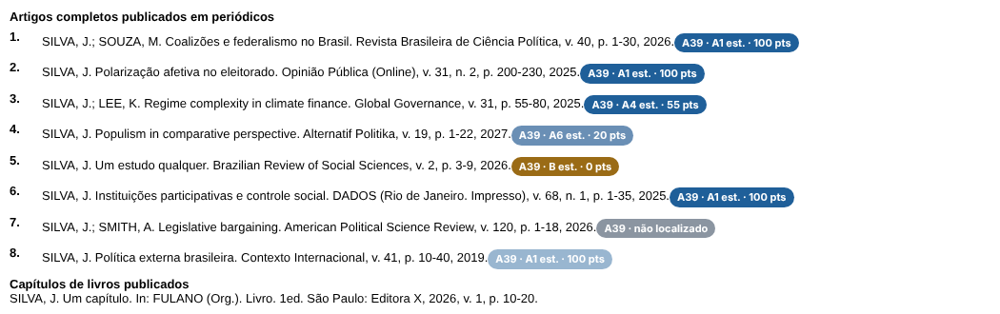
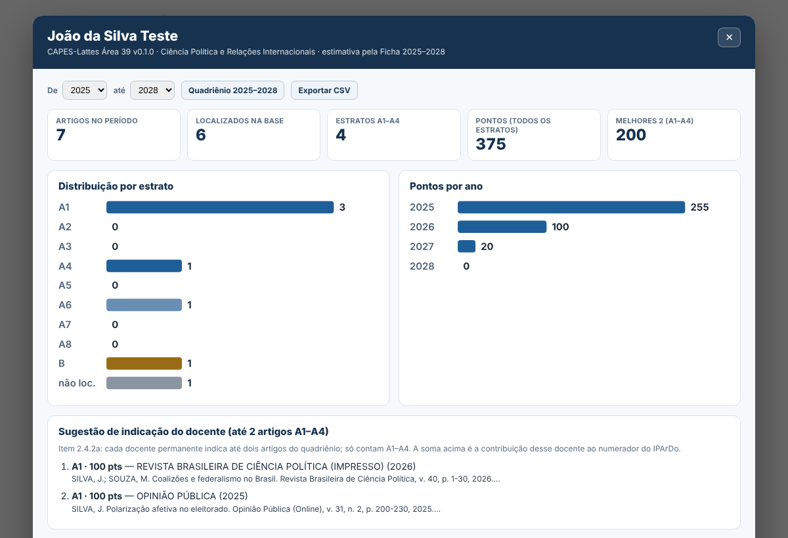

# CAPES-Lattes — Área 39

**Ciência Política e Relações Internacionais**

Extensão para Google Chrome que lê os **artigos completos publicados em periódicos** de um Currículo Lattes e mostra, para cada um, o **estrato estimado (A1–A8 ou B)** e a **pontuação** conforme a **Ficha de Avaliação 2025–2028 da Área 39 da CAPES**.

**[⬇️ Baixar a versão mais recente](https://github.com/cruz-neto/capes-lattes-area39/releases/latest)**

> [!IMPORTANT]
> **Os estratos exibidos são estimativas, não a classificação oficial.** A classificação oficial dos artigos será feita pela Área 39 na avaliação de 2029. Esta é uma ferramenta acadêmica independente, sem vínculo com a CAPES, o CNPq ou a Plataforma Lattes.

## Funcionalidades

- **Selo em cada artigo** com o estrato estimado e os pontos (ex.: `A39 · A2 est. · 85 pts`). Ao passar o mouse, aparecem o periódico, o ISSN e o Qualis 2021–2024 de origem.
- **Painel no próprio currículo** com:
  - filtro de período (padrão: quadriênio 2025–2028);
  - distribuição dos artigos por estrato;
  - pontos por ano;
  - **sugestão dos dois artigos A1–A4 que o docente deveria indicar**, com a soma que entra no IPArDo;
  - lista completa dos artigos e exportação em CSV.
- **Busca do periódico** pelo **ISSN** informado pelo Lattes e, na falta dele, pelo **título**.
- **Bônus Scopus** (+50 pontos) configurável na página de opções.
- **Nada sai do navegador:** a extensão não envia dados a nenhum servidor.

Imagens geradas com um currículo fictício.

## Instalação

1. Em **[Releases](https://github.com/cruz-neto/capes-lattes-area39/releases/latest)**, baixe o arquivo `CAPES-Lattes-Area39-vX.Y.Z.zip` e descompacte.
2. No Chrome, acesse `chrome://extensions`.
3. Ative o **Modo do desenvolvedor** (canto superior direito).
4. Clique em **Carregar sem compactação** e selecione a pasta descompactada, a que contém o arquivo `manifest.json`.
5. Abra um Currículo Lattes em [buscatextual.cnpq.br](https://buscatextual.cnpq.br). Os selos aparecem ao lado dos artigos, e o botão **Abrir painel** fica no canto inferior direito.

Se você baixou o código-fonte inteiro (botão verde *Code → Download ZIP*), selecione a subpasta `extension`.

## Como a estimativa é feita

### A regra da Área 39 (Ficha de Avaliação 2025–2028, itens 2.3.1 e 2.4.2a)

- Os artigos são classificados em **nove estratos (A1 a A8 e B)**.
- Os estratos A1–A8 seguem **percentis do índice h5 do Google Scholar**, calculados em **duas listas**:
  - periódicos ibero-americanos e lusófonos, ou de "estudos de área";
  - demais periódicos.
- O estrato **B** reúne periódicos sem informação suficiente ou sem boas práticas editoriais.

| Estrato | A1 | A2 | A3 | A4 | A5 | A6 | A7 | A8 | B |
|---|:-:|:-:|:-:|:-:|:-:|:-:|:-:|:-:|:-:|
| **Pontos** | 100 | 85 | 70 | 55 | 25 | 20 | 10 | 5 | 0 |

- **Bônus:** +50 pontos para periódicos no primeiro quintil (top 20%) da Scopus em *Political Science and International Relations*, *Sociology and Political Science* ou *Public Administration*.
- **Docentes permanentes:** cada um indica **até 2 artigos** do quadriênio, e **só contam A1–A4**. IPArDo = (A1·100 + A2·85 + A3·70 + A4·55) / nº de docentes permanentes.
- **Discentes e egressos:** todos os estratos contam (IPPArD/E).

### A conversão usada pela extensão

O Qualis Periódicos 2021–2024 da Área 39 foi construído com o **mesmo método**: h5 do Google Scholar, as mesmas duas listas e oito estratos, com ajuste da comissão em 3,2% das revistas. A extensão parte da classificação publicada pela área na Plataforma Sucupira e faz a correspondência direta:

| Qualis 2021–2024 | A1 | A2 | A3 | A4 | B1 | B2 | B3 | B4 | C |
|---|:-:|:-:|:-:|:-:|:-:|:-:|:-:|:-:|:-:|
| **Estrato estimado 2025–2028** | A1 | A2 | A3 | A4 | A5 | A6 | A7 | A8 | B |

A base contém **2.911 periódicos (ISSNs)** classificados pela Área 39. Os detalhes estão em [docs/METODOLOGIA.md](docs/METODOLOGIA.md).

## Limitações

- **Estimativa:** os cortes de percentil serão recalculados em 2029, com o h5 atualizado. Um periódico pode subir ou descer de estrato.
- **Periódicos fora da lista** aparecem como "não localizado". A lista da Sucupira inclui apenas periódicos em que a Área 39 teve publicações em 2021–2024, então mesmo revistas de alto impacto podem ficar de fora.
- **Bônus Scopus:** depende de uma lista de ISSNs informada pelo usuário na página de opções. A extensão não consulta a Scopus. O quartil do SCImago (top 25%) não equivale ao critério da Ficha (top 20%).
- **Livros e capítulos** recebem avaliação qualitativa da comissão (L1–L5, CL1–CL5) e não são classificados.
- **Identificação dos dados:** o reconhecimento depende da qualidade dos dados do Currículo Lattes, como ISSN ausente ou título do periódico registrado de forma diferente.

Para fins institucionais ou decisórios, confira sempre as fontes oficiais.

## Privacidade

A extensão lê apenas o conteúdo visível do Currículo Lattes aberto no navegador e guarda localmente um resumo da última análise e as preferências do usuário. Ela não coleta, envia, vende nem compartilha dados. Veja [PRIVACY.md](PRIVACY.md).

## Relatar problemas

Encontrou um periódico não reconhecido ou um estrato que parece errado? Abra uma [issue](https://github.com/cruz-neto/capes-lattes-area39/issues/new/choose) e informe, se possível:

- nome do periódico e ISSN;
- ano do artigo;
- o que a extensão mostrou e o que você esperava;
- uma captura de tela.

## Para desenvolvedores

A arquitetura, a atualização da base e a adaptação para outras áreas da CAPES estão em [docs/ARQUITETURA.md](docs/ARQUITETURA.md). Contribuições são bem-vindas: veja [CONTRIBUTING.md](CONTRIBUTING.md).

## Como citar

> Claudiano. *CAPES-Lattes — Área 39 (Ciência Política e Relações Internacionais)*. Software, versão 0.1.0. Universidade Federal do Recôncavo da Bahia (UFRB), 2026. Disponível em: https://github.com/cruz-neto/capes-lattes-area39.

Os metadados de citação estão em [CITATION.cff](CITATION.cff). No GitHub, use o botão *Cite this repository*.

## Fontes

- CAPES. *Ficha de Avaliação — Ciência Política e Relações Internacionais (Área 39), Quadriênio 2025–2028*.
- CAPES. *Documento de Área — Ciência Política e Relações Internacionais, 2025–2028*.
- CAPES/DAV. *Relatório da Comissão de Qualis Periódicos — Ciência Política e Relações Internacionais*, 2025.
- Plataforma Sucupira. *Classificações publicadas — Qualis Periódicos 2021–2024, Área 39*.

## Créditos e licença

Distribuído sob a [licença MIT](LICENSE).

Inspirado em [CAPES-Lattes — Área 27](https://github.com/nepeconunb/capes-lattes-area27), do NEPECON/UnB (MIT, DOI [10.5281/zenodo.23267483](https://doi.org/10.5281/zenodo.23267483)).
